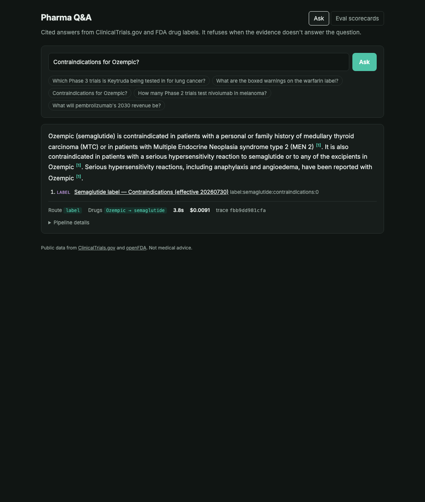
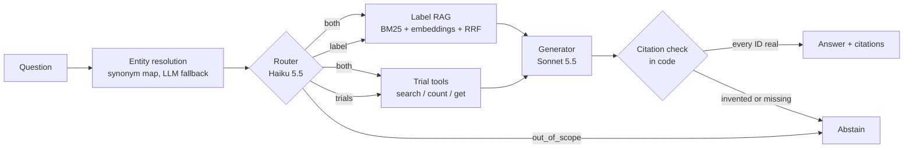
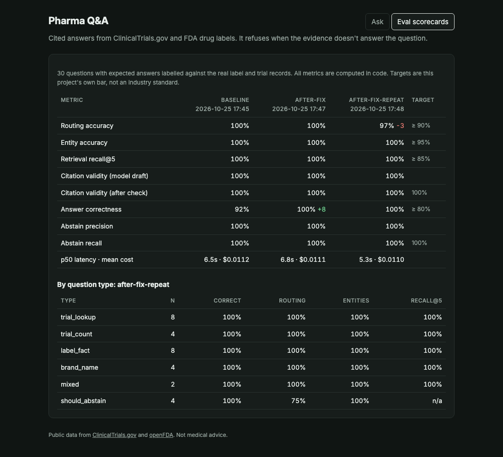

# Pharma Q&A

A small question-answering service over public drug and clinical-trial data. It cites its sources, refuses when the
evidence is thin, and ships with an eval scorecard.

- **Trials** come from the [ClinicalTrials.gov API v2](https://clinicaltrials.gov/data-api/api) as structured data, reached through typed tools.
- **Drug labels** come from [openFDA](https://open.fda.gov/apis/drug/label/) as documents, reached through hybrid RAG.
- **The eval:** 30 questions labelled against the real records, scored in code, with a baseline, one fix and a rerun.



## Run it

You need an Anthropic API key. All the data (labels, embeddings, synonym map, cached trial responses) is committed,
so nothing has to be ingested first.

```bash
cp .env.example .env              # then set ANTHROPIC_API_KEY
docker compose up --build         # http://localhost:8000
```

Without Docker (needs [uv](https://docs.astral.sh/uv/)):

```bash
uv sync
uv run uvicorn app.main:app --port 8000     # demo page + POST /ask, API docs at /docs
uv run python -m eval.run --tag mine        # the 30-question scorecard (~$0.33 per run)
uv run pytest                               # 18 offline unit tests, fake LLM, no key needed
```

To share it with someone, send the repo link: `docker compose up` is the whole setup. The page takes deep links:
`/?q=Contraindications%20for%20Ozempic%3F` asks a question on load, and `/#scores` opens the scorecards.

```bash
curl -s localhost:8000/ask -H 'content-type: application/json' \
  -d '{"question": "How many Phase 2 trials test nivolumab in melanoma?"}'
# -> {answer, citations, route, entities, abstained, abstain_reason, trace_id, latency_ms, cost_usd, ...}
```

## Architecture



The trust story is the last box. The model can only cite evidence the pipeline handed it, and code, not the model,
decides whether a citation is real. An invented citation ID, or an answer with no citations, is downgraded to an
abstain.

| Module | What it does |
|---|---|
| [`app/entities.py`](app/entities.py) | Matches brand and generic names against a synonym map built from label metadata (Ozempic → semaglutide). The LLM extracts mentions only when nothing matched. Unknown drugs are kept and flagged. |
| [`app/router.py`](app/router.py) | Haiku 5.5 with structured output: `trials \| label \| both \| out_of_scope`, plus a standalone `label_query` (the fix below). |
| [`app/tools/trials.py`](app/tools/trials.py) | Typed ClinicalTrials.gov tools. Pydantic validates every argument before a request goes out. **Counting is done in code** (`totalCount`), never by the model. Disk cache for repeatable evals. |
| [`app/rag/`](app/rag/) | One canonical prescription label per drug (53 drugs, 3,306 chunks), chunked by label section with the section name as metadata. Search is BM25 plus `bge-small` embeddings, merged with Reciprocal Rank Fusion and filtered by the resolved drug. Optional cross-encoder rerank. |
| [`app/generate.py`](app/generate.py) | Sonnet 5.5 returns a Pydantic `DraftAnswer`. The post-check validates every cited ID, both the `citations` list and inline `[id]` markers. |
| [`app/trace.py`](app/trace.py) | One JSON trace per request: entities, route, tool calls, retrieved IDs, the model draft, every LLM call's tokens, latency and cost. |

## Scorecard



| Metric | Baseline | After fix | Repeat | Target |
|---|---:|---:|---:|---:|
| Routing accuracy | 100% | 100% | 96.7% | ≥ 90% |
| Entity accuracy | 100% | 100% | 100% | ≥ 95% |
| Retrieval recall@5 | 100% | 100% | 100% | ≥ 85% |
| Citation validity (model draft) | 100% | 100% | 100% | |
| Citation validity (after check) | 100% | 100% | 100% | 100% |
| **Answer correctness** | **92.3%** | **100%** | **100%** | ≥ 80% |
| Abstain precision / recall | 100% / 100% | 100% / 100% | 100% / 100% | recall 100% |
| p50 latency · mean cost | 6.5 s · $0.011 | 6.8 s · $0.011 | 5.3 s · $0.011 | report only |

The question mix is 8 trial lookups, 4 trial counts, 8 label facts, 4 brand-name questions, 2 mixed and 4 that should
abstain ([`eval/questions.jsonl`](eval/questions.jsonl)). Expected sources and `must_contain` strings were filled in
by reading the real label sections and trial records, before any LLM code ran. The targets are this project's own
bar, not an industry standard. Full runs are in [`eval/results/`](eval/results/).

### The fix: query decomposition for label search

The baseline failed q25 and q16. Both traces showed the same cause: the label search ran on the **whole question**.

- **q25** asked: "Is pembrolizumab in any Phase 3 lung cancer trials, and what are its common adverse reactions?" The
  trial half dragged retrieval toward lung-cancer-specific adverse-reaction chunks. The label's summary chunk
  ("most common adverse reactions… fatigue, …") never reached the top 5, so the answer said the list wasn't available.
- **q16** asked: "What does the isotretinoin label say about use in pregnancy?" The answer was faithful but incomplete.
  Retrieval found the pregnancy subsection, not the boxed warning ("life-threatening birth defects"), which is the
  most important pregnancy evidence on that label.

**Fix:** the router now also returns `label_query`, the label part of the question rewritten as a standalone search
query ("pembrolizumab adverse reactions", "isotretinoin pregnancy"). Correctness went from 92.3% to 100%, with no
latency or cost change. The repeat run held 100% correctness. Its one routing miss (q28, a drug not in the corpus,
routed `out_of_scope` instead of `label`) still abstained correctly, because corpus coverage is checked in code and
doesn't depend on the router.

### Things the build turned up

- **The spec's API parameter was wrong.** ClinicalTrials.gov v2 has no `filter.phase`; phases go through
  `aggFilters=phase:2 3`. Found by probing the API before writing the client.
- **openFDA metadata has gaps.** The Tecentriq and Tagrisso labels have no harmonized `openfda` block, so a metadata
  search misses them entirely. They're found by product-data text instead, with a two-entry brand override.
- **Golden answers have to come from the source.** The Ozempic label says "MTC", not "medullary thyroid carcinoma",
  so the grader accepts either. Writing the answer from memory would have produced a false failure.
- **The reranker didn't earn its place.** With correct entities, label recall@5 was 14/14 without the cross-encoder
  and 13/14 with it, so it ships off (`USE_RERANKER=1` turns it on).
- **The first eval run crashed.** Concurrent inference on the embedding model segfaults, which would also have hit
  FastAPI's threadpool in production. Inference is now serialized behind a lock (about 10 ms per query).

## Limitations, said plainly

- **30 questions is small, and the system hits the ceiling.** 100% here means "no failures this set can detect", not
  "no failures". The next step is a harder, larger set: misspellings, multi-drug questions, dosing nuance, and
  questions where the label is ambiguous.
- **Grading is string matching.** It's cheap, deterministic and explainable, but brittle: a correct paraphrase can
  fail. At scale I'd add an LLM judge calibrated against expert labels.
- **The trials data is a snapshot.** Responses are cached on disk (committed), so eval runs are repeatable and stay
  under the 50 requests/min limit. Counts reflect the registry on 2026-10-25. Live questions with new arguments fetch
  fresh data.
- **One canonical label per drug**, the most recent prescription label with the most sections, not every
  manufacturer's label. That avoids near-duplicate chunks, but generic and repackager variants aren't searchable.
- **Synonyms come from label metadata, not an ontology.** There's no fuzzy matching, so a misspelled brand falls
  through to the LLM fallback.
- p50 latency is about 6 s, mostly the Sonnet generation call. Streaming the answer would make it feel faster.

## What I'd do next at production scale

1. **Replace the synonym map with a curated ontology** (MeSH, RxNorm, or an in-house drug and disease taxonomy). That
   gives entity resolution for conditions as well as drugs, and condition hierarchy for trial search ("NSCLC" ⊂ "lung cancer").
2. **Move retrieval to a managed index** (e.g. Azure AI Search, hybrid with semantic ranking) over the full label
   corpus, with scheduled reindexing keyed on the label `effective_time` and version, and freshness shown per citation.
3. **Make the eval a CI gate.** A larger golden set labelled by domain curators, a calibrated LLM judge alongside the
   string checks, repeated runs to measure variance, and online feedback from real users flowing back into the set.

## Repo layout

```
app/
  main.py            FastAPI: POST /ask, demo page, /api/scorecards, per-IP rate limit
  pipeline.py        resolve → route → tools / retrieve → generate → check
  entities.py        synonym map + LLM fallback
  router.py          route + label_query
  tools/trials.py    ClinicalTrials.gov client and typed tools
  rag/ingest.py      openFDA pull, section chunking, synonym map
  rag/search.py      BM25 + embeddings + RRF (+ rerank)
  generate.py        Answer model, citation post-check
  llm.py             LLMClient interface (Anthropic implementation), token cost tracking
  trace.py           per-request JSON traces
data/                labels.jsonl, embeddings.npy, synonyms.json, cache/trials/
eval/                questions.jsonl, run.py (scorecard), results/, traces/ (traces for saved runs)
tests/               offline unit tests with a fake LLM
web/index.html       demo page (no build step)
```

Rebuild the label data from scratch with `uv run python -m app.rag.ingest && uv run python -m app.rag.search --build`
(openFDA allows 1,000 requests a day without a key).
